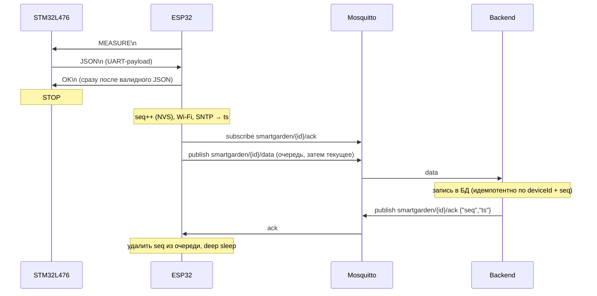

# Protocol — STM32 ↔ ESP32 ↔ MQTT ↔ backend

Состояние: **V1 — работает** (STM32F103, ветка `v1-f103`, установленное устройство). **V2 — спецификация от 2026-10-25, ещё не реализована** (STM32L476, задачи FW-2-1, ESP-1-1, ESP-2-3, ESP-2-4, BE-1-1, BE-1-3, BE-1-4).
Железо — `docs/hardware.md`. При изменении этого файла обновлять разделы payload в `CLAUDE.md` и `README.md` в той же ветке.

---

## 1. Последовательность обмена

### V1 (установленный F103)

1. ESP32 просыпается, шлёт `MEASURE\n` по UART (115200 8N1) — это же будит STM32 из STOP.
2. STM32 измеряет и шлёт одну JSON-строку, завершённую `\n`.
3. ESP32 подключается к Wi-Fi и MQTT, публикует строку в `smartgarden/{deviceId}/data` (QoS 0).
4. ESP32 шлёт `OK\n` — независимо от результата публикации. Без JSON за 60 с `OK` не отправляется; STM32 засыпает по своему таймауту ACK 30 с.
5. Оба засыпают; ESP32 — deep sleep 60 мин.

### V2



1. ESP32 шлёт `MEASURE\n` сразу после пробуждения, до Wi-Fi (STM успевает измерить, пока ESP подключается).
2. STM32 отвечает одной JSON-строкой (UART-payload, раздел 3).
3. ESP32 проверяет строку (валидный JSON, длина ≤ `PAYLOAD_MAX_LEN`) и **сразу** шлёт `OK\n`. STM32 засыпает, не дожидаясь сервера. Невалидная строка игнорируется, ожидание продолжается до общего таймаута 60 с; без валидного JSON `OK` не отправляется.
4. ESP32 присваивает измерению `seq` (раздел 4), подключается к Wi-Fi, получает время по SNTP и ставит `ts` (раздел 4).
5. ESP32 подписывается на `smartgarden/{deviceId}/ack`, публикует сначала записи из очереди неотправленных (от старых к новым), затем текущее измерение.
6. Backend сохраняет измерение и **после фиксации транзакции** публикует ack (раздел 6).
7. ESP32 ждёт ack на каждый `seq` с таймаутом `SERVER_ACK_TIMEOUT_MS` (ориентир 5 с). Подтверждённые записи удаляются из очереди, неподтверждённые остаются (раздел 7). Затем deep sleep.

**Совместимость:** STM32 F103 и L476 ведут себя одинаково по UART; ранний `OK` для F103 допустим (F103 просто засыпает раньше). Новая ESP работает с обеими прошивками STM.

---

## 2. Команды UART

| Направление | Строка | Значение |
|---|---|---|
| ESP → STM | `MEASURE` | выполнить одно измерение, ответить JSON. Принимается также `MEASURE\r\n` |
| STM → ESP | `{…}` | одна JSON-строка, ≤ `PAYLOAD_MAX_LEN` байт вместе с `\n` |
| ESP → STM | `OK` | JSON принят, STM может спать |

Сервисные команды (`VERSION`, `PING`, `CAL …`) — FW-5-3, будут описаны здесь. Строка длиннее лимита отбрасывается целиком (FW-1-2). Неизвестные строки игнорируются.

---

## 3. Payload

### V1 (F103)

```json
{"deviceId":2,"temperature":24.50,"soil":[78,45,23,90],"soilRaw":[8200,11800,14100,7600],"adsReady":true,"battery":3812}
```
На F103 сбой ADS даёт `soil` 100 и `soilRaw` 0 — backend фильтрует такие каналы (BE-1-1).

### V2 — UART-payload (STM → ESP)

```json
{"deviceId":3,"fw":"2.0.0","temperature":21.50,
 "soil":[78,null,23,90, null,null,null,null, null,null,null,null, 45,51,60,38],
 "soilRaw":[8200,-3,14100,7600, -1,-1,-1,-1, -2,-2,-2,-2, 11800,10500,9300,12700],
 "modules":["ok","absent","error","ok"],
 "air":{"t":12.4,"h":81,"p":1013.2},
 "battery":3812,"status":0}
```

### V2 — MQTT-payload (ESP → `smartgarden/{deviceId}/data`)

UART-payload плюс два поля, которые добавляет ESP:

```json
{ …, "seq":1042, "ts":1761400000 }
```

### Поля V2

| Поле | Тип | Кто ставит | Значение |
|---|---|---|---|
| `deviceId` | int | STM | ID устройства; топик строится по `DEVICE_ID` шлюза, поле только сверяется (ESP-1-2) |
| `fw` | string | STM | версия прошивки STM, `"2.x.y"` |
| `temperature` | number \| null | STM | DS18B20 (почва), °C, 2 знака; `null` — сбой |
| `soil` | array[16] of int \| null | STM | влажность 0…100 %; `null` — канал недоступен |
| `soilRaw` | array[16] of int | STM | сырое значение ADS1115 0…32767 или **код ошибки < 0** (таблица ниже) |
| `modules` | array[4] of string | STM | статус модуля: `"ok"`, `"absent"`, `"error"` — **источник истины статуса модуля** |
| `air` | object | STM | BME280: `t` °C (1 знак), `h` % (целое), `p` гПа (1 знак); каждое поле `null` при сбое |
| `battery` | int \| null | STM | мВ |
| `status` | uint32 | STM | битовая маска (FW-4-2) |
| `seq` | uint32 | ESP | монотонный номер измерения (раздел 4) |
| `ts` | int \| null | ESP | Unix-время измерения, с; `null` — время неизвестно |

Канал `i` (0…15) принадлежит модулю `i / 4`, по умолчанию модуль `m` = зона `m+1` (`docs/hardware.md`).
Неизвестные поля принимающая сторона игнорирует.

### Коды ошибок в `soilRaw`

Прошивка ограничивает нормальное значение диапазоном 0…32767 (небольшие отрицательные значения ADS у нуля → 0), поэтому отрицательное число — всегда код. Если код есть, в `soil` — `null`.

| Код | Причина | Уровень |
|---|---|---|
| `-1` | модуль отсутствует (контакт присутствия разомкнут) | модуль |
| `-2` | модуль не отвечает (ADS1115: NACK или таймаут I2C) | модуль |
| `-3` | обрыв датчика (raw < `RAW_OPEN_MAX`) | канал |
| `-4` | замыкание или насыщение (raw > `RAW_SHORT_MIN`) | канал |
| `-5` | таймаут конверсии ADS1115 | канал |
| `-6` | сбой канала TCA9548A | модуль |

**Согласованность (обязательно, хост-тест в FW-2-1):**
- `modules[m] == "absent"` ⇔ все 4 канала модуля `m` имеют `soilRaw = -1`;
- `modules[m] == "error"` ⇔ все 4 канала модуля `m` имеют один и тот же код `-2` или `-6`;
- `modules[m] == "ok"` ⇒ в каналах модуля нет кодов `-1`, `-2`, `-6`;
- код `< 0` ⇔ `soil = null`.

При расхождении backend доверяет `modules` и пишет предупреждение в лог.

Стенд без контактов присутствия: неотвечающий модуль — `"error"` / `-2` (отсутствие от отказа не отличить).

### Длина

| | Наихудший случай | Типичный |
|---|---|---|
| UART-payload | 374 байта | ~300 |
| MQTT-payload (+ `seq`, `ts`) | 407 байт | ~315 |

Наихудший случай посчитан для максимальных значений всех полей (`deviceId` 65535, `status` и `seq` = 2³²−1, 16 значений `soilRaw` по 5 цифр, `"absent"` ×4).

**`PAYLOAD_MAX_LEN = 512` байт вместе с `\n`** — контракт для всех сторон:

| Где | Размер | Задача |
|---|---|---|
| STM, буфер TX | 512 | FW-2-1 |
| ESP, приёмный буфер UART (`Serial2.setRxBufferSize`, до `begin()`) | 1024 | ESP-1-1 |
| ESP, лимит строки | 512, длиннее — отбросить | ESP-1-1 |
| ESP, `PubSubClient::setBufferSize` | 1024 (payload + топик + заголовок) | ESP-1-1 |

Приёмный буфер UART ESP по умолчанию — 256 байт, а JSON приходит, пока ESP подключается к Wi-Fi и не читает UART: без увеличения буфера payload V2 обрежется.

---

## 4. `seq` и `ts`

### `seq`
- Монотонный счётчик **на ESP32**, хранится в NVS, переживает сброс, deep sleep и отключение питания.
- Увеличивается и сохраняется в NVS **до** первой отправки, при получении валидного JSON от STM. Каждое измерение получает новый `seq`; повторная отправка из очереди — с исходным `seq`.
- Сбрасывается только при стирании NVS (полная очистка Flash). Как backend отличает такой сброс от дубля — BE-1-3.
- NVS: ~24 записи в сутки, wear leveling NVS это выдерживает.

### `ts`
- Время **измерения**, а не отправки. Ставит ESP: `ts = время_SNTP − (millis() − момент получения JSON) / 1000`.
- SNTP при каждом пробуждении с таймаутом (нужен и для TLS, ESP-2-1). У ESP32 DevKit нет кварца 32 кГц — часы ESP в deep sleep уходят на минуты за час, без SNTP им не доверять.
- Нет времени SNTP → `ts: null`; backend ставит время приёма.
- Повторная отправка из очереди — с исходным `ts`.
- `ts` — только время измерения, **не** ключ уникальности.

---

## 5. Идемпотентность

- Ключ уникальности — **`deviceId + seq`** (BE-1-3). Повтор с тем же ключом не создаёт новых записей, но **подтверждается** ack, иначе ESP не очистит очередь.
- Payload V1 без `seq` — без проверки дублей (как сейчас).

---

## 6. MQTT

| Топик | Кто публикует | Кто подписан | QoS | Payload |
|---|---|---|---|---|
| `smartgarden/{deviceId}/data` | ESP32 | backend | 0 (`PubSubClient` публикует только QoS 0) | MQTT-payload |
| `smartgarden/{deviceId}/ack` | backend | ESP32 этого устройства | 0 | `{"seq":1042,"ts":1761400000}` |

- Ack публикуется только после успешной фиксации в БД; для дубля — тоже.
- Невалидное сообщение не подтверждается (ESP повторит его, пока запись не вытеснится из очереди) — backend пишет предупреждение в лог.
- ACL Mosquitto (OPS-1-2): устройство пишет только в свой `data` и читает только свой `ack`; backend читает `smartgarden/+/data` и пишет `smartgarden/+/ack`.

---

## 7. Очередь неотправленных (ESP)

- Запись без ack за `SERVER_ACK_TIMEOUT_MS` (или без Wi-Fi / MQTT) остаётся в очереди и досылается при следующем пробуждении.
- Очередь ограничена `QUEUE_MAX` записями; при переполнении вытесняется самая старая (в лог). Место хранения (RTC-память или LittleFS) и `QUEUE_MAX` — решение ESP-2-4.
- Ограничение времени: отправка очереди не продлевает активную фазу ESP сверх общего таймаута цикла (`CLAUDE.md`: устройство не остаётся бодрствующим из-за сбоя связи).

---

## 8. Биты `status`

Определяются в FW-4-2. Кандидаты от V2: DS18B20 fail, BME280 fail, battery low, battery floating, I2C recovered, NTC аккумулятора неисправен, заряд запрещён по температуре, источник заряда отсутствует.
